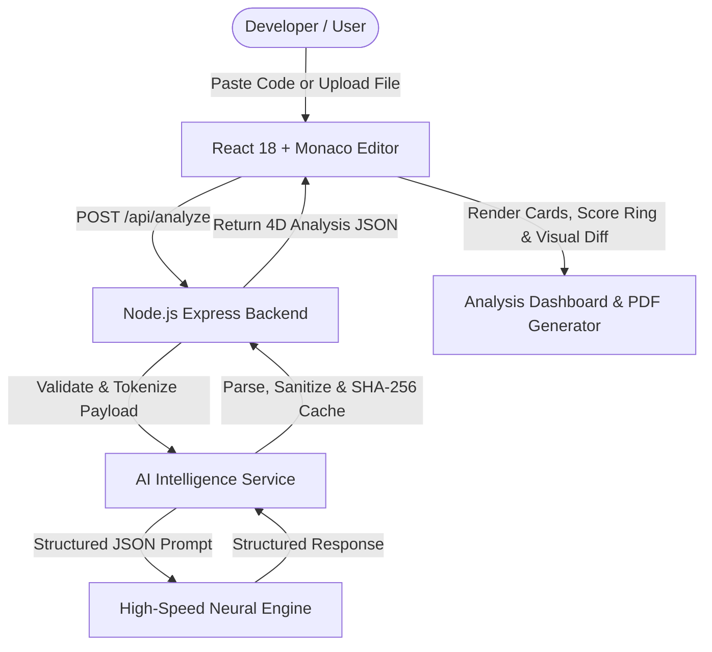

# 🚀 AI Code Review Assistant

> **An autonomous instant code intelligence platform that reviews code, detects vulnerabilities, identifies performance bottlenecks, and generates production-ready refactors — all in under 3 seconds.**


---

## 🌟 Key Features

- 📁 **Multi-File Workspace (V3):** Add, upload, or drag-and-drop up to 10 files simultaneously with dynamic tabs and file-specific findings drill-down.
- ⚡ **In-Browser & Sandboxed Execution Workspace (V3):** Run code directly with instant terminal feedback. In-browser isolated Web Worker for JS/TS; secure sandboxed process for Python (`CPython 3.14`), C/C++ simulator, and Node.js.
- 🖥️ **Live Execution Terminal (V3):** Integrated drawer showing STDOUT, STDERR/Stack trace, Exit code, execution timer (ms), and strict decoupling disclaimer (*code execution success $\neq$ bug-free code*).
- 📊 **Project-Level Executive Dashboard (V3):** Global quality score, cross-file architectural summary, and aggregate metric counters (Total Bugs, Security Risks, Performance Flaws).
- 🧩 **Large-File Chunking Engine (V3):** Overlapping section analysis for files exceeding 25,000 characters up to 150KB with transparent `isIncomplete` disclosure (zero silent truncation).
- 🐛 **4-Dimensional Code Review:** Analyzes code for Bugs & Syntax Errors, Performance Bottlenecks, Security Risks, and Best Practice Suggestions.
- 🛡️ **Clean Review Status:** Displays strict `No bugs detected.` when no actionable issues exist—zero synthetic false-positives.
- ⚡ **Sub-3-Second Latency:** Ultra-fast neural inference pipeline running at 300+ tokens/sec.
- 🛠️ **Instant Code Refactoring:** Generates clean, production-ready refactored code with inline comments and type safety hints.
- 🔍 **Git-Style Diff Viewer:** Inspect before-and-after improvements side-by-side or unified with colorized syntax chunks.
- 💻 **Monaco Code Editor:** Full IDE experience with syntax highlighting, line numbers, and multi-language support.
- 🎯 **1-Click Portfolio Demo Presets:** Test pre-built buggy JavaScript, inefficient Python, SQL/XSS risk, and C++ memory leak snippets in one click.
- 📄 **Executive PDF Export:** Download professional audit reports with quality scores and breakdown summaries using `jsPDF`.
- 🌙 **Sleek Dark Mode UI:** Modern glassmorphism developer dashboard UI built with Tailwind CSS & Framer Motion.

---

## 🏗️ System Architecture



---

## 🛠️ Tech Stack

| Layer | Technology | Description |
|---|---|---|
| **Frontend** | React 18 + Vite | Modern, fast interactive UI |
| **Code Editor** | Monaco Editor | VS Code-grade in-browser editor |
| **Diff Viewer** | diff library | Split & unified Git-style diff inspection |
| **Styling** | Tailwind CSS + Framer Motion | Sleek dark glassmorphism dashboard & animations |
| **Icons** | Lucide React | Clean developer-first iconography |
| **Backend** | Node.js + Express | REST API handling input validation & file uploads |
| **File Processing** | Multer | In-memory stream parsing for `.js`, `.py`, `.java`, `.cpp` |
| **AI Inference** | Ultra-Fast LLM API | High-throughput model fallback chain (300+ tokens/sec) |
| **Report Export** | jsPDF | Client-side PDF executive report compiler |

---

## 🚀 Getting Started

### ⚡ Quick Start (Global One-Command)

Run both the Express backend and React/Vite frontend concurrently with a single command from the root directory:

```bash
# 1. Install all dependencies (Server + Client)
npm run install:all

# 2. Start Fullstack Development Environment
npm run dev
```

- **Backend API:** `http://localhost:5000`
- **Frontend UI:** `http://localhost:3000`

---

### 📦 Manual Setup (Separate Processes)

#### 1. Backend Setup
```bash
cd server
npm install
```
Create a `.env` file inside `server/`:
```env
PORT=5000
GROQ_API_KEY=your_api_key_here
```
Start the backend server:
```bash
npm run dev
```
*Note: If no API key is provided, the server automatically operates in **Smart Fallback Mode** for offline demos.*

#### 2. Frontend Setup
```bash
cd client
npm install
npm run dev
```
Open `http://localhost:3000` in your browser.

---

## 📚 Documentation

| Document | Description |
|---|---|
| [PRD.md](PRD.md) | Product Blueprint & Direction (Single living document) |
| [PROGRESS.md](PROGRESS.md) | Live progress & active task checklist |
| [client/README.md](client/README.md) | Frontend architecture & guide (React 18 + Vite + Tailwind) |
| [server/README.md](server/README.md) | Backend API & setup guide (Express + Groq) |
| [docs/ROADMAP.md](docs/ROADMAP.md) | Release plan & API evolution roadmap |
| [docs/architecture.md](docs/architecture.md) | System design & data flow |
| [docs/api.md](docs/api.md) | Unified API contracts (v1 & v2 combined) |
| [docs/ui-ux.md](docs/ui-ux.md) | UI/UX specifications & design tokens |
| [docs/testing.md](docs/testing.md) | Test plan, test cases & quality gates |
| [docs/development.md](docs/development.md) | Fullstack development & contribution guide |
| [docs/demo-script.md](docs/demo-script.md) | Live demo presentation walkthrough |
| [CHANGELOG.md](CHANGELOG.md) | Release history (SemVer) |
| [AGENTS.md](AGENTS.md) | Guidance for AI coding agents |

---

## 📄 License
MIT License. Built for portfolio & demonstration purposes.
