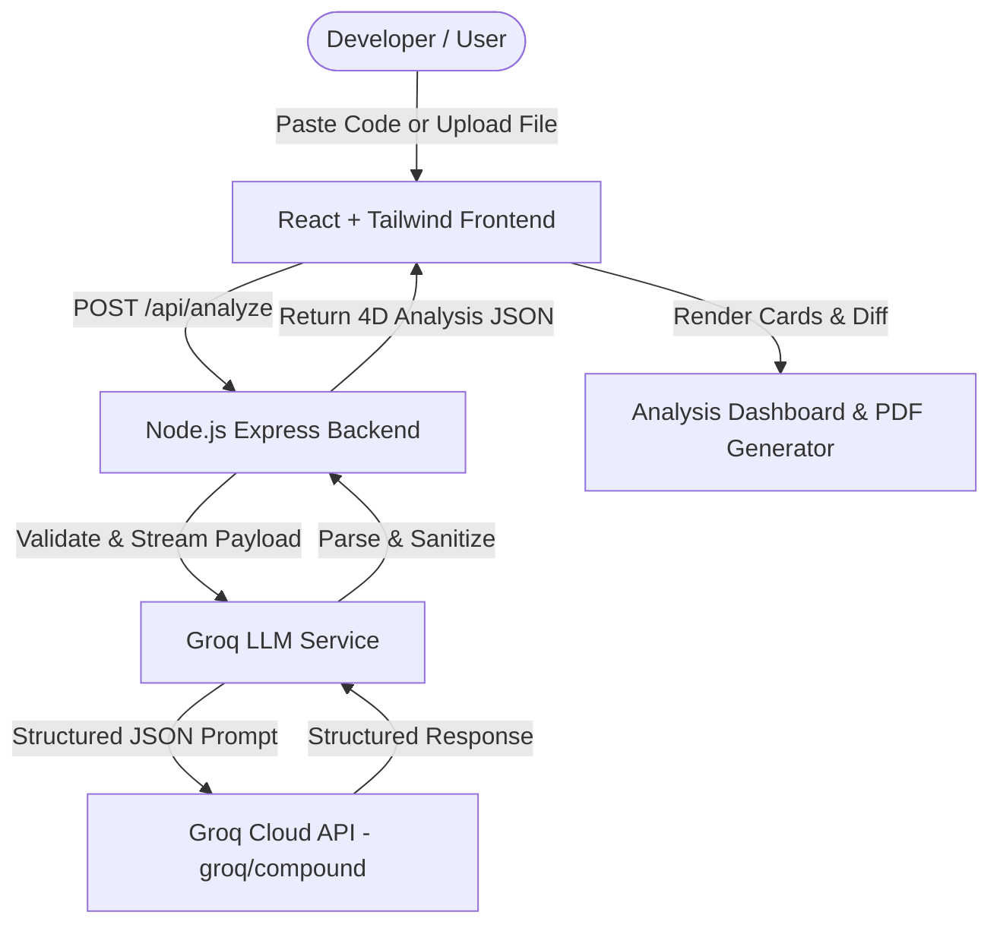

# 🚀 AI Code Review Assistant

> **A developer tool powered by Groq's LLM that instantly reviews code, identifies bugs, security flaws, performance bottlenecks, and generates refactored code — all in under 3 seconds.**


---

## 🌟 Key Features

- 🐛 **4-Dimensional Code Review:** Analyzes code for Bugs & Syntax Errors, Performance Bottlenecks, Security Risks, and Best Practice Suggestions.
- ⚡ **Sub-3-Second Latency:** Leverages Groq's high-speed inference engine (`groq/compound-mini`) running at 300+ tokens/sec.
- 🛠️ **Instant Code Refactoring:** Generates clean, production-ready refactored code with inline comments and type safety hints.
- 📁 **File Upload Support:** Upload `.js`, `.py`, `.java`, `.cpp`, `.ts`, `.go` files directly via Multer file stream.
- 🎯 **1-Click Portfolio Demo Presets:** Test pre-built buggy JavaScript, inefficient Python, SQL/XSS risk, and C++ memory leak snippets in one click.
- 📄 **Executive PDF Export:** Download professional PDF reports with quality scores and breakdown summaries using `jsPDF`.
- 🌙 **Sleek Dark Mode UI:** Modern glassmorphism developer dashboard UI built with Tailwind CSS & Framer Motion.

---

## 🏗️ System Architecture



---

## 🛠️ Tech Stack

| Layer | Technology | Description |
|---|---|---|
| **Frontend** | React 18 + Vite | Modern, fast interactive UI |
| **Styling** | Tailwind CSS + Framer Motion | Sleek dark glassmorphism dashboard & animations |
| **Icons** | Lucide React | Clean developer-first iconography |
| **Backend** | Node.js + Express | REST API handling input validation & file uploads |
| **File Processing** | Multer | In-memory stream parsing for `.js`, `.py`, `.java`, `.cpp` |
| **LLM Provider** | Groq API (`groq/compound-mini`) | Ultra-fast inference engine (300+ tokens/sec) |
| **Report Export** | jsPDF | Client-side PDF executive report compiler |

---

## 🚀 Getting Started

### 1. Prerequisites
- Node.js (v18 or higher)
- Groq API Key ([Get free key here](https://console.groq.com/))

### 2. Backend Setup
```bash
cd server
npm install
```
Create a `.env` file inside `server/`:
```env
PORT=5000
GROQ_API_KEY=your_groq_api_key_here
```
Start the backend server:
```bash
npm start
```
*Note: If no API key is set, the server automatically operates in **Smart Fallback Mode** for offline demos.*

### 3. Frontend Setup
```bash
cd client
npm install
npm run dev
```
Open `http://localhost:3000` in your browser.

---

## 📄 License
MIT License. Built for portfolio & demonstration purposes.
