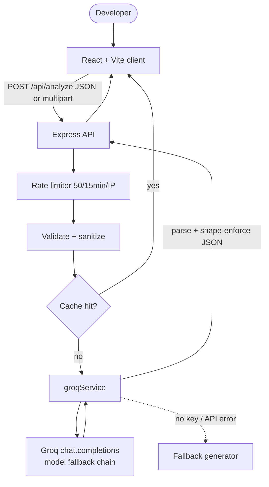
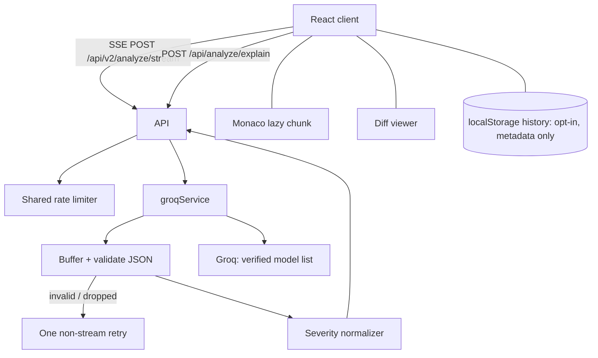

# Architecture

Requirements: [PRD.md](../PRD.md). API details: [api.md](api.md).

## 1. Overview



## 2. Deployment

| Piece | Host | Notes |
|---|---|---|
| Client | Vercel | Static build `client/dist`; `vercel.json` rewrites `/api/*` to the Render API and all else to `index.html` |
| API | Render | `node server.js`; `trust proxy` (default 1) so rate limiting sees real client IPs |
| Local dev | localhost | Vite :3000 proxies `/api` → :5000 |

## 3. Backend

| File | Responsibility |
|---|---|
| `server/server.js` | env check, CORS, rate limiter, body parsers (5 MB), `/api/health`, mounts router |
| `server/routes/analyze.js` | accept JSON or file(s), `/api/analyze` & `/api/analyze/multi`, resolve language, validate, sanitize control chars, cache, call service |
| `server/routes/execute.js` | sandboxed execution runner (`/api/execute`), Python subprocess, C/C++ simulator, Node runner, 4000ms timeout |
| `server/middleware/upload.js` | Multer memory storage, 150 KB per file, max 10 files, extension / `text/*` allow-list |
| `server/services/groqService.js` | multi-file aggregation, large-file chunking (>25k chars), model chain, JSON parse, shape enforcement, clean review status |

**Request lifecycle:** rate limit → Multer (if file upload) → validate (non-empty, ≤ 150 KB) → sanitize → cache lookup (SHA-256 hash) → resolve language → Groq call / chunking → parse (strip ```json fences) → enforce shape → cache (non-fallback only) → respond with `executionTimeMs`.

**Multi-file lifecycle:** batch validation (1-10 files) → bounded concurrency execution (2 files at a time) → aggregate project summary (overall score, total bugs/security/performance metrics) → per-file structured findings → unified JSON payload.

**Large-file lifecycle:** files > 25,000 characters are processed across overlapping logical sections (up to ~60,000 chars) → merged deduplicated findings → transparent `isIncomplete` flag when exceeding window.

**Model chain:** tried in order until one returns content. 429 → rate-limit error. Auth / 400 / model errors → fallback review. The list is configuration and must be verified against Groq's current catalog before each release.

## 4. Frontend

| Component | Role |
|---|---|
| `App.jsx` | state (`files` array, `activeFileIndex`, review analysis, timing, error), dual-mode runner (`/api/analyze` & `/api/analyze/multi`), 40/60 layout |
| `Header` | sticky title bar, v3 status badge, engine indicator |
| `CodeInput` | Monaco IDE, multi-file tab bar (`+ Add File`), bulk uploader, drag-and-drop, presets, dynamic CTA, Run Code trigger |
| `CodeWorkspaceTerminal` | sandboxed execution terminal, STDOUT, STDERR/Stack trace, Exit code, timing, decoupling disclaimer |
| `LanguageDropdown` | glassmorphic animated language selector |
| `AnalysisDashboard` | project-level overview, file tabs, radial score, 4D finding cards, clean `No bugs detected.` status |
| `DiffViewer` | side-by-side & unified Git diff inspector |
| `ExplainModal` | on-demand AI diagnostic explanation modal |
| `ProgressToast` | real-time multi-stage analysis progress indicator |
| `ExportPanel` | copy Markdown, copy refactored code, PDF (jsPDF), share |
| `ErrorBoundary` | crash isolation |
| `SamplePresets.js` | four demo snippets |

State is local React hooks; no global store.

## 5. LLM integration

- **Provider:** Groq (`groq-sdk`), chat completions, temperature 0.2.
- **System prompt:** senior-reviewer persona; must respond **only** with one JSON object with keys `summary, qualityScore, bugs, performance, security, suggestions, refactoredCode` (shapes in [api.md](api.md#response-200-ok)).
- **User prompt:** language + the code in a fenced block, asking for all five categories.
- **Parsing:** tolerate fenced JSON; fill missing keys with defaults; `qualityScore` defaults to 75 when non-numeric.
- **Fallback mode:** when the key is missing/placeholder or Groq returns auth/400/model errors, a canned review is generated and flagged `isFallback: true`. It is never cached.

## 6. Target architecture for Release 4.0 (V4 — Launching Next Week)



| Layer | Change |
|---|---|
| Client | Monaco, score ring, severity badges, diff tab, SSE reader, explain buttons, history panel, MD/PDF/JSON export |
| API | v2 stream and explain routes, severity normalizer, `detectLanguage` module, enforced CORS, labelled fallback |
| Config | Model list and token budget in config, not inline |

**Client storage (opt-in history):** key `acra.history.v1`, max 10 records, FIFO, fields `id, ts, language, score, counts{critical,warning,info}, summary`. No raw or refactored code unless the user explicitly opts in.

## 7. Cross-cutting concerns

| Concern | Approach |
|---|---|
| Security | Key server-side only; CORS allow-list enforced; rate limit; input size caps; no code in logs |
| Privacy | No DB, no disk writes; cache is RAM only and keyed by hash |
| Reliability | Model chain; one retry on bad/dropped stream; explicit errors rather than silent fake results |
| Performance | Cache (1 h / 100 entries), lazy Monaco, memoized result sections |
| Observability | Log status and truncated message only; add request id and model used (never code) |

## 8. Known issues

| Issue | Planned in |
|---|---|
| CORS callback accepts every origin | Roadmap 2.0 Phase 0 |
| Cache keys hold raw code | 2.0 Phase 0 |
| 400/auth errors masked as a successful fake review | 2.0 Phase 0 |
| Upload path capped at 25,000 chars despite 2 MB Multer limit | Resolved in 2.5 (harmonized to 30 KB) |
| Rate limiter is in-memory per instance (resets on restart, not shared) | Backlog |
